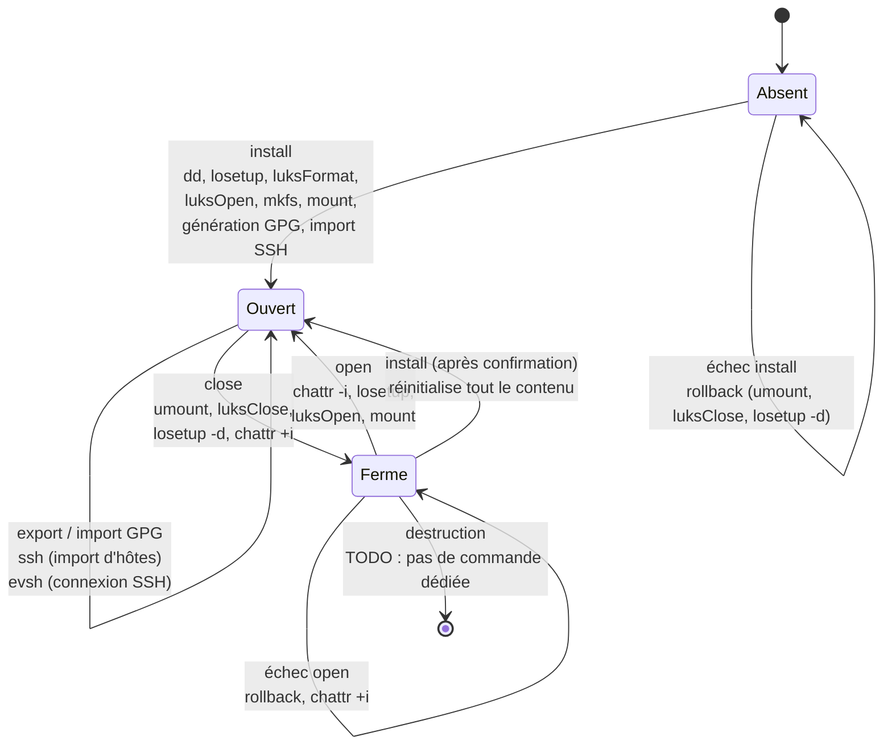

# coffre.sh

Script bash qui crée et gère un coffre chiffré LUKS2 dans un fichier conteneur, et y range les clés GPG et SSH de l'utilisateur. Ces clés ne sont ainsi lisibles que coffre ouvert. Les opérations sur le périphérique tournent en root, celles sur les clés sous l'utilisateur réel.

Projet académique d'administration Linux, validé sur une VM Debian. La chaîne `dd → losetup → luksFormat → luksOpen → mkfs.ext4` était imposée par le sujet.

## Cycle de vie



Au repos (état « Fermé »), le conteneur est un fichier chiffré marqué immuable (`chattr +i`), et aucun mapping ni loop device n'est attaché. Le script n'a pas de commande de destruction : il faut supprimer le fichier à la main après `chattr -i`. Ce manque est traité dans [SECURITY.md](SECURITY.md).

## Commandes

| Commande | Effet | Privilèges |
|---|---|---|
| `install` | Crée le conteneur de 5 Go, le chiffre, le formate et le monte. Crée l'arborescence, la config SSH durcie et l'alias `evsh`. Génère la paire GPG et exporte la clé publique, propose l'import d'hôtes SSH, puis ajoute les raccourcis au `.bashrc`. | root (`sudo`) |
| `open` | Lève l'immuabilité, attache le loop, déverrouille LUKS et monte. Rollback en cas d'échec. | root (`sudo`) |
| `close` | Démonte, ferme LUKS, détache le loop et repose `chattr +i`. | root (`sudo`) |
| `export [--private] [--id ID]` | Copie la clé publique du trousseau vers le coffre ; avec `--private`, la clé privée aussi, après confirmation. | utilisateur, coffre ouvert |
| `import [--private]` | Importe dans le trousseau les clés publiques du coffre ; avec `--private`, les clés privées aussi, après confirmation. | utilisateur, coffre ouvert |
| `ssh` | Importe un hôte, tous les hôtes ou aucun depuis `~/.ssh/config`. Copie les clés et réécrit `IdentityFile`. | utilisateur, coffre ouvert |

Raccourcis ajoutés au shell : `O` (ouvrir et entrer), `C` (sortir et fermer), `S`, `I`, `IP`, `E`, `EP`. La connexion se fait avec `evsh <hôte>`, qui appelle `ssh -F` sur la config du coffre.

## Mécanismes de sécurité

**Chiffrement LUKS2.** Protège le contenu du conteneur au repos contre la lecture du fichier ou du disque, par exemple en cas de vol de la machine ou de copie du fichier. Le script utilise les paramètres par défaut de `cryptsetup` pour LUKS2 : chiffrement et dérivation de clé ne sont pas fixés explicitement.

**Gestion des clés GPG.** La paire est générée en mode batch, sans adresse e-mail dans l'UID, et ciblée par empreinte. La passphrase est saisie de façon masquée, jamais en argument. L'export de la clé privée demande une confirmation et crée le fichier avec `umask 077`. Cela réduit l'exposition de la clé privée hors du coffre et les erreurs de manipulation.

**Séparation de privilèges.** Seules les opérations bloc, LUKS et montage tournent en root. Les opérations GPG et SSH redescendent vers l'utilisateur réel (`$SUDO_USER`) avec `sudo -u`. Le trousseau de root n'est pas touché, et les clés restent la propriété de l'utilisateur.

**Rollback transactionnel.** `install` et `open` enregistrent les étapes accomplies et, en cas d'échec (`trap ERR`), défont ces étapes dans l'ordre inverse. Pas de mapping LUKS ni de loop device orphelin, et le conteneur est remis immuable.

**Journal d'audit.** Chaque action (installation, ouverture, fermeture, export, import, ajout d'hôte SSH) est horodatée avec l'utilisateur réel dans `journal.log`, à l'intérieur du coffre. Le fichier est marqué append-only (`chattr +a`). Le journal n'est lisible que coffre ouvert. Il ne trace ni les échecs d'ouverture ni les actions faites hors du script : voir les limites.

**Config SSH durcie.** `IdentitiesOnly yes`, `StrictHostKeyChecking ask`, `HashKnownHosts yes`, et un `known_hosts` propre au coffre. Seule la clé prévue est proposée au serveur, et l'historique des connexions ne fuit pas dans `~/.ssh`.

**Immuabilité au repos.** `chattr +i` sur le conteneur fermé empêche sa suppression ou sa modification accidentelle, y compris par root, tant que l'attribut n'est pas levé.

Ce que ces mécanismes ne couvrent pas est décrit dans [SECURITY.md](SECURITY.md).

## Prérequis et installation

- Linux avec `cryptsetup` (LUKS2), `losetup`, `e2fsprogs`, `chattr` (système de fichiers ext4 ou compatible pour `+i` et `+a`), `gnupg` et `openssh-client`.
- `sudo` pour `install`, `open` et `close`.
- Sur Debian et dérivées, `install` installe lui-même les paquets manquants avec `apt-get`.

```bash
# Installer le script hors du home, en root, pour qu'il ne soit pas modifiable
# par l'utilisateur (voir SECURITY.md, point M3)
sudo install -o root -g root -m 755 coffre.sh /usr/local/sbin/coffre.sh

sudo coffre.sh install   # crée, chiffre, monte, génère GPG, importe SSH
sudo coffre.sh close
sudo coffre.sh open
```

Les variables suivantes peuvent être surchargées : `VAULT_CONTAINER` (défaut `/opt/coffre/coffre.img`), `VAULT_MOUNT` (`/mnt/coffre`), `VAULT_MAPPER`, `VAULT_SIZE_GB` (5), `DD_SOURCE` (`/dev/zero`), `GPG_NAME`, `GPG_KEYSIZE` (4096) et `GPG_EXPIRE` (`1y`).
